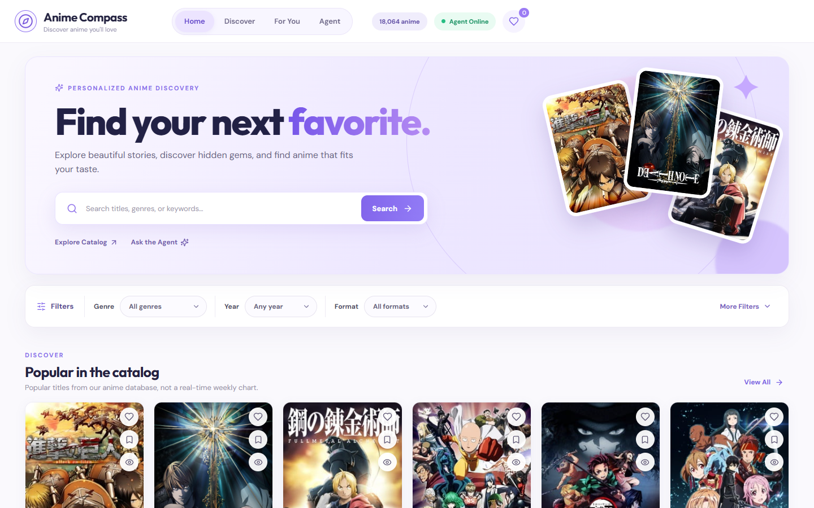
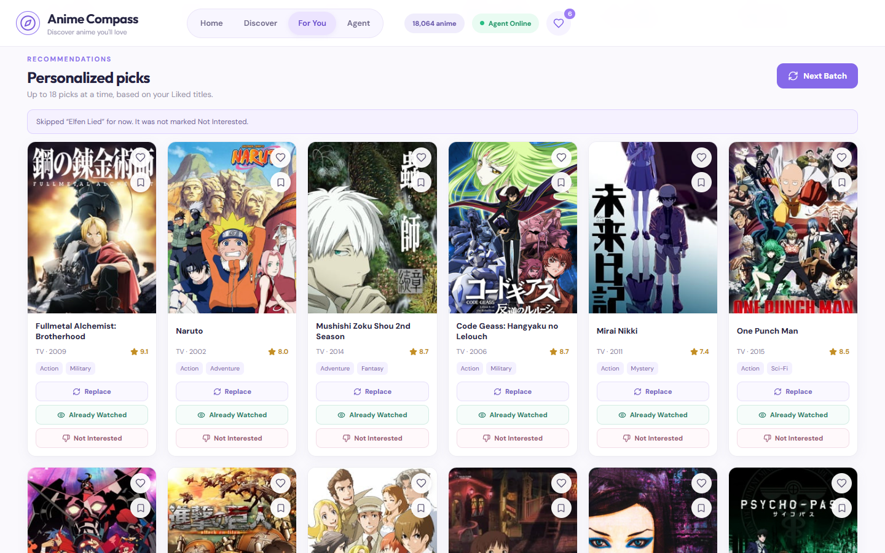
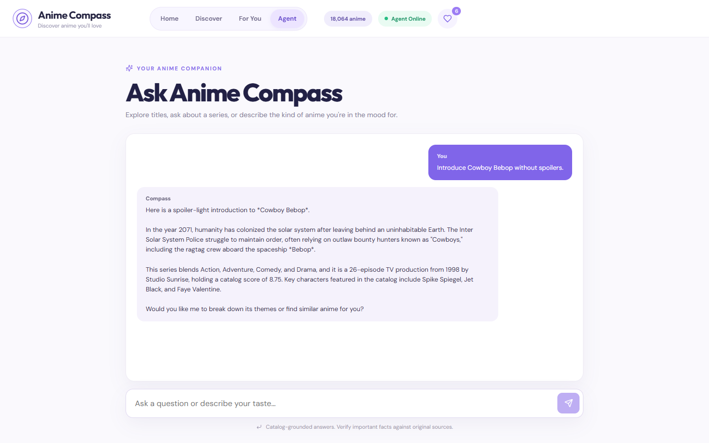

# Anime Compass

A personalized anime recommender you can actually use: Like a few titles and it ranks an 18,064-title
catalog against your taste with an implicit-feedback ALS model and a LambdaMART reranker. The models are built
from 57.6 million historical ratings, of which 30.9 million positive interactions train the production model.
A React app serves the feed, and a small catalog-grounded assistant answers questions in plain English.

**Live app: https://anime-compass-b2c6mriqrq-uc.a.run.app/**
&nbsp;·&nbsp; [Technical demo (Streamlit)](https://anime-compass-xijwv9hjuqvoskonhrwtus.streamlit.app/)

The service scales to zero, so the first request after a quiet period waits about a minute while the models load.



## What it does

- **Personalized feed.** Like titles and get 18 picks at a time, ranked for your profile. Paging continues
  through one ranked sequence and never shows a title twice.
- **Feedback that means what it says.** Like, Want to Watch, Already Watched, Not Interested and Replace are
  five different signals, and only a Like moves the model.
- **Catalog search and filters** over 18,064 titles by genre, year, format, score, length and studio.
- **Ask Compass.** Introductions, cast and staff lookups, rankings and recommendations in natural language,
  answered only from catalog data.

| Personalized picks | Ask Compass |
|---|---|
|  |  |

Screenshots are of the live site. There are no accounts: a profile lives in the browser.

## Architecture

One container on Google Cloud Run serves everything. FastAPI answers `/api` and serves the compiled React
bundle at `/`, so there is no separate frontend host and no CORS.

```text
 Browser: React 19 + Vite (frontend/)
        |  same-origin /api
        v
 FastAPI (app/) ----------------------------------------------.
        |                          |                          |
        v                          v                          v
 Fast path (default)        Constraint path             Ask Compass
 ALS top-300 retrieval      multi-channel hybrid        Gemini parses one intent
 + LambdaMART rerank        for studio / voice-actor    -> backend picks and runs
 NumPy + LightGBM           / year style constraints       catalog tools
                                                        -> Gemini phrases the
                                                           verified result
```

| Layer | What it is |
|---|---|
| Frontend | React 19, Vite 6, plain CSS. 77 unit tests on Node's built-in runner. |
| API | FastAPI, Pydantic v2, SQLite for anonymous sessions. |
| Retrieval | Implicit-feedback ALS, 128 factors, served as frozen item factors with NumPy fold-in. |
| Reranking | LambdaMART (LightGBM) over the ALS top 300. |
| Assistant | Gemini for intent parsing and wording only, with a deterministic fallback. |
| Hosting | One Docker image, Cloud Run, 1 vCPU / 4 GiB, scale to zero. Model artifacts are checksum-verified. |

Detail: [docs/ARCHITECTURE.md](docs/ARCHITECTURE.md) and [docs/SYSTEM_REFERENCE.md](docs/SYSTEM_REFERENCE.md).

## Offline evaluation

Every number below ranks each held-out user's favourites against the **full catalog**, using all of that
user's held-out positives. This is much harder than the common one-positive-against-99-sampled-negatives
protocol, so the scores look small; NDCG@10 is a ranking-quality score, not an accuracy percentage.

**Retrieval: ALS replaced the previous architecture.** One benchmark, the same 800 held-out users:

| Architecture | NDCG@10 | Recall@10 | Offline p50 |
|---|---:|---:|---:|
| Previous hybrid + CountSketch | 0.1815 | 0.1682 | 924.6 ms |
| **ALS fast path** | **0.2588** | **0.2480** | **2.0 ms** |

**Reranking: LambdaMART over ALS.** A separate confirmation set of 800 users that no earlier experiment
had scored, opened once:

| Ranker | NDCG@10 | Recall@10 |
|---|---:|---:|
| ALS alone | 0.2456 | 0.2312 |
| **ALS + LambdaMART (shipped)** | **0.2828** | **0.2537** |

These two tables come from **different user samples and must not be combined or chained**. Each comparison
is paired within its own sample: +0.0773 NDCG@10 (95% CI `[+0.0641, +0.0897]`) for ALS over the hybrid, and
+0.0372 (95% CI `[+0.0276, +0.0465]`) for the reranker over ALS.

Honest limitations:

- **Offline only.** There are no real users and no A/B test behind these numbers. They measure how well held-out
  favourites are reconstructed, not satisfaction.
- **No timestamps, and the data ends in 2020.** This is preference reconstruction, not next-item prediction,
  and newer titles have little or no interaction history.
- **Popularity bias.** ALS candidates are head-heavy: only 6 to 8% of the catalog reaches any benchmark user's
  top 10. The reranker improves ordering, not discovery.
- **Latency is an offline figure.** 2.0 ms is the ranking computation on a dedicated machine. The hosted
  service on one shared vCPU is far slower end to end.
- **Several ideas were tested and rejected**: pretrained synopsis embeddings, learned fusion weights,
  segment-aware routing and LightFM. The records are kept, not hidden.

Protocol and decision records: [docs/EVALUATION.md](docs/EVALUATION.md),
[`data/evaluation/personalized/results/`](data/evaluation/personalized/results/), and the V2.1 diagnostics in
[`experiments/v21_quality/`](experiments/v21_quality/).

## Pagination and feedback

`POST /api/recommend/page` serves the feed 18 titles at a time from **one ranked sequence** per profile.

- The request carries the profile and a cursor, never the list of titles already shown, so it does not grow
  as you page.
- The cursor is stateless: any instance can rebuild the sequence, so paging survives a restart.
- A cursor from a different profile or deployment is refused with `409` rather than guessed at.
- The first window is exactly the production ranking (ALS top 300, LambdaMART order, one entry per franchise).
  Deeper windows continue down the ALS ranking in the same way, for four windows.

| Action | Meaning | Effect on recommendations |
|---|---|---|
| Like | Positive preference | The only input to the ALS profile |
| Want to Watch | Future intent | Hidden from the feed; not a Like |
| Already Watched | Seen, no judgement | Hidden from the feed; neither Like nor dislike |
| Not Interested | Explicit negative | Hidden, and recorded as disliked |
| Replace | "Not this one right now" | Skipped for this visit; nothing stored |

More in [frontend/README.md](frontend/README.md).

## What the assistant is, and is not

Ask Compass is a constrained pipeline, not an autonomous agent.

1. Gemini turns the message into **one structured intent**, validated by Pydantic.
2. The backend re-reads literal constraints from the message, chooses the tools and runs them against the catalog.
3. Gemini is called once more to phrase the verified result. If its wording fails the grounding check, the
   deterministic catalog answer is served instead.

The model never calls a tool, never picks or reorders titles, and cannot change a stored preference on its
own: a preference is written only when the user's own message states it ("I liked X", "don't recommend X"),
which the backend decides from the text before any tool runs. If Gemini is unavailable, catalog search,
ranking and recommendations still work through rule-based parsing.

Known limits: a correct answer that does not repeat the title verbatim is rejected by the grounding check and
replaced by the catalog answer, and replies are slow on the hosted service, roughly 10 seconds for a lookup
and 40 for a recommendation.

## Tests and deployment

- **Backend:** more than 700 pytest tests covering ranking, pagination, feedback semantics, artifact integrity,
  the intent schema, tool routing, write safety and grounding. Ruff, ruff-format and mypy are enforced.
- **Frontend:** 77 unit tests and a production build.
- **CI** (GitHub Actions) runs four jobs on every push: React, Python on 3.10 and 3.12, FastAPI serving the
  freshly built bundle, and the Streamlit demo's minimal install. No job uses a secret or calls Gemini.
- **Deployment:** Cloud Build builds `Dockerfile.cloudrun`, then runs the image with no network and no
  credentials and refuses to publish it if that check fails. Cloud Run deploys by image digest. The V2.1
  revision was verified at 0% traffic, including live Gemini requests, before it was promoted.

The revision in production was built from tag
[`v2.1.0`](https://github.com/Seiitsu77/anime-compass/tree/v2.1.0); the digest, build and verification record
are in [docs/V21_DEPLOYMENT_CHECKS.md](docs/V21_DEPLOYMENT_CHECKS.md). `main` has since moved the React source
into `frontend/` and removed the legacy frontend, which the next image will pick up. Setup and rollback:
[docs/CLOUD_RUN_DEPLOYMENT.md](docs/CLOUD_RUN_DEPLOYMENT.md).

## Run locally

Requires Python 3.10+ and Node.js 20.19+ or 22.12+.

```bash
# Backend
python -m venv .venv
source .venv/bin/activate              # Windows: .venv\Scripts\Activate.ps1
python -m pip install -r requirements-dev.txt
python -m pip install -e . --no-deps
python scripts/download_artifacts.py --repo-id Seiitsu/anime-compass-data   # ~190 MB, checksum-verified
cp .env.example .env                   # GEMINI_API_KEY is optional

# Frontend
cd frontend
npm ci
npm run build
cd ..

python run_app.py                      # http://127.0.0.1:8000
```

For UI work, run `npm run dev` in `frontend/` instead of building; Vite serves on port 5173 and proxies `/api`
(see [frontend/README.md](frontend/README.md)). Without a Gemini key everything except natural-language
phrasing still works; `/api/health` then reports `degraded`, because the provider has no key and the optional
semantic channel is off by default.

```bash
python -m pytest -q                    # backend
cd frontend && npm test                # frontend
```

The Streamlit technical demo has its own two-package runtime:

```bash
python -m pip install -r requirements.txt
python scripts/download_artifacts.py --repo-id Seiitsu/anime-compass-data --artifact als_production_item_factors.npz --artifact anime_catalog_serving.json
python -m streamlit run streamlit_app.py
```

## Repository layout

```text
frontend/                 React + Vite web app (source, tests)
app/                      FastAPI service: API routes, agent orchestration, services
backend/anime_agent/      Recommendation core: ALS serving, reranker, hybrid, agent rules, evaluation harness
scripts/                  Build, evaluate, verify and deploy
tests/                    Backend regression and contract tests
experiments/v21_quality/  V2.1 offline diagnostics, kept apart from the application
data/evaluation/          Experiment reports and decision records
docs/                     Architecture, evaluation, deployment
streamlit_app.py          Technical demo
Dockerfile.cloudrun       The production image
```

## Data and license

Derived from [Anime Recommendation Database 2020](https://www.kaggle.com/datasets/hernan4444/anime-recommendation-database-2020),
released under [CC0 1.0](https://creativecommons.org/publicdomain/zero/1.0/); see
[DATASET_ATTRIBUTION.md](DATASET_ATTRIBUTION.md). Model artifacts are hosted in the
[`Seiitsu/anime-compass-data`](https://huggingface.co/datasets/Seiitsu/anime-compass-data) dataset repository.
Source code is [MIT](LICENSE).

This is a portfolio project.
